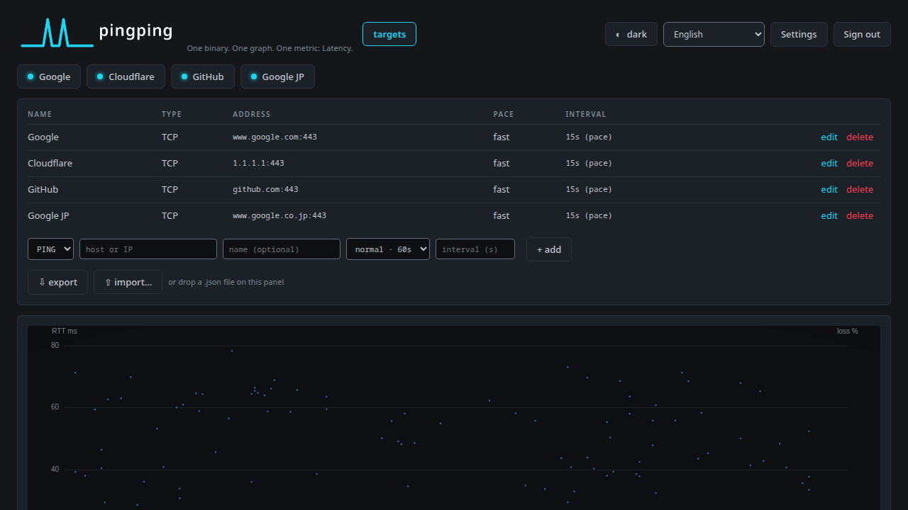

<p align="center">
  
  
</p>

> ### A SmokePing-like latency tool for Windows, Linux and macOS.
> **One file — just download and run.**
>
> *🚫 No Perl. No RRDtool. No web server. No config files.*




## Quick start

**Step 1 — download and start it** (Linux x86-64, one command):

```bash
mkdir -p ~/pingping && cd ~/pingping && curl -LO https://github.com/githubflyideas/pingping/releases/download/v0.7.12/pingping-linux-amd64 && mv pingping-linux-amd64 pingping && chmod +x pingping && ./pingping
```

**Step 2 — open it.** Go to <http://localhost:8518>. The first screen
asks you to create the admin account: pick a user name and a password.
There is no default password, and nothing to set on the command line —
the terminal's last line points you here. A demo target
(`www.google.com`) is already there, so your first graph appears within
a minute.

**Step 3 — add your own targets.** Click **✎ targets** and add yours:
a host name or IP, watched by ping, TCP or HTTP. Everything — targets,
accounts, the password — is changed in the console, while it runs.

**Windows:** download
[pingping-0.7.12-setup.exe](https://github.com/githubflyideas/pingping/releases/download/v0.7.12/pingping-0.7.12-setup.exe)
and run it. It asks for a port (8518 is fine), installs pingping as a
service, and opens the console in your browser at the end — the same
first screen, create the admin account. A tray icon shows the status.

**macOS (Apple silicon):** download
[pingping-darwin-arm64](https://github.com/githubflyideas/pingping/releases/download/v0.7.12/pingping-darwin-arm64),
then `chmod +x pingping-darwin-arm64` and run it — same steps as Linux.

## Going live

Every line below is ready to copy as printed:

| I want to… | Run |
|---|---|
| Just run it | `./pingping` |
| Use another port | `./pingping --port 9000` |
| Keep 90 days of history (default is 300) | `./pingping --days 90` |
| Put the data somewhere else | `./pingping --data /path/to/dir` |
| Check a setup before (re)starting | `./pingping check` |
| Check this machine's clock is fine for sub-ms graphs | `./pingping selftest` |
| Make a Zabbix token | `./pingping gen-token zabbix.token` |
| Show all commands | `./pingping help` |

The data lives in a `data` folder next to the program, so moving
pingping means moving one folder. Every start prints a short security
summary (where it listens, whether a login exists, what is on); anything
exposed is marked `!`. To run it as a service on Linux, use the ready
unit file in [deploy/pingping.service](deploy/pingping.service).

> **Ping shows 100% loss?** On Linux, ping needs one permission first.
> Allow it once:
> `echo 'net.ipv4.ping_group_range = 0 2147483647' | sudo tee /etc/sysctl.d/99-pingping.conf && sudo sysctl --system`
> or give the program the capability instead:
> `sudo setcap cap_net_raw+ep ./pingping`
> (TCP and HTTP targets need nothing.)

## What it does

- Keeps **every single measurement** — not averages — for up to 300
  days, so the chart shows the real shape of a link: the spread, the
  spikes, the loss bursts.
- Watches as many targets as you like, each at its own pace, and
  compares a period against yesterday or last week.
- One small file for Windows, Linux and macOS. No database or web
  server to install.
- **No ads, and no requests of its own** beyond the targets you set.

Good for: watching your home or office line and catching ISP packet
loss with proof, comparing two routes over a day, keeping an eye on
servers and gateways over months.

## Multi-point monitoring

One pingping measures from one place. To watch the same services
**from several locations**, run one pingping per location and let
**Zabbix** pull them together. Start with `--zabbix` and a token:

```bash
./pingping gen-token zabbix.token
PINGPING_ZABBIX_TOKEN_FILE=zabbix.token ./pingping --zabbix
```

Zabbix then polls a read-only stats page (`GET /api/stats`): per
target, the last five minutes' p50/p90/p99, loss and loss bursts. It is
the same contract as fogping, so the
[fogping Zabbix 7.0 template](https://github.com/githubflyideas/fogping/tree/main/zabbix/template_fogping/7.0)
works unchanged — just set `{$FOGPING.URL}` to `http://<host>:8518`.
Off by default; without `--zabbix` nothing changes. On Windows, keep
the token file in a folder only the service account and administrators
can open. Before restarting a service, `./pingping check` with the same
flags says whether it would start, and why not.

## Export / import targets

In the console, **✎ targets → ⇩ export** downloads your targets as a
JSON file; **⇧ import…** shows a preview — what will be added, skipped
or rejected, and why — before anything changes. Import only adds:
existing targets are never changed or removed. Export is open to every
signed-in account; import is admin-only. The same file works in
[fogping](https://github.com/githubflyideas/fogping). Format spec:
[docs/targets-format.md](docs/targets-format.md) · JSON Schema:
[docs/targets.schema.json](docs/targets.schema.json).

## HTTP API

The console, the tray icon and the Zabbix template all use one JSON
API: [docs/API.md](docs/API.md) · OpenAPI 3.1:
[docs/openapi.yaml](docs/openapi.yaml).

---

Friendly link: [SmokePing](https://github.com/oetiker/SmokePing) ·
Sibling project: [fogping](https://github.com/githubflyideas/fogping) (one binary, embedded SQLite, Web UI) ·
[⭐ Star](https://github.com/githubflyideas/pingping) ·
[GitHub Sponsors](https://github.com/sponsors/githubflyideas)

## License Terms

pingping is licensed under the [Elastic License 2.0](LICENSE). Versions up to and including v0.5.9 were released under the Apache License 2.0.


pingping is free for any individual or organization, including commercial use, provided that the original logo, project name, and author attribution are retained.

The only paid option: replacing the original logo with a custom or corporate logo requires a one-time payment of $12 for a perpetual license.

Selling, reselling, renting, or offering pingping as a paid service to others is prohibited.

To purchase a license, contact the author: route66traffic66@gmail.com
